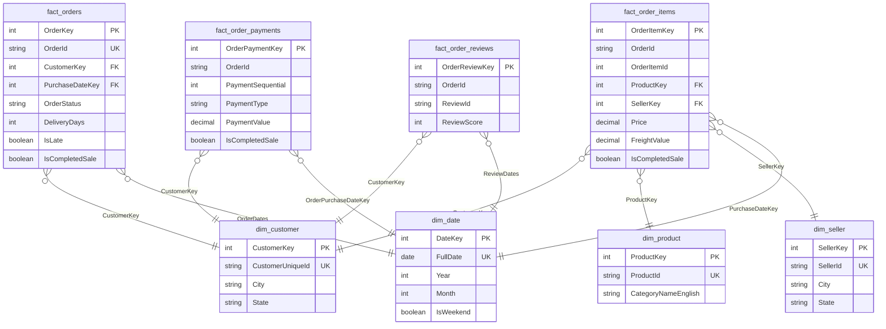

# Olist SQL Server Data Warehouse

Data engineering portfolio project based on the **Brazilian E-Commerce Public Dataset by Olist**.

The project builds a data warehouse in **Microsoft SQL Server**, using a Bronze / Silver / Gold medallion architecture. The entire pipeline — SQL Server, data preprocessing and the full Bronze-to-Gold load — runs in Docker and can be started with a single script.

## Contents

* [Source data](#source-data)
* [Project status](#project-status)
* [Architecture](#architecture)
* [Technologies](#technologies)
* [Quick start](#quick-start)
* [Data preprocessing](#data-preprocessing)
* [Bronze layer](#bronze-layer)
* [Silver layer](#silver-layer)
* [Gold layer — dimensional model](#gold-layer--dimensional-model)
* [Example business queries](#example-business-queries)
* [Manual execution](#manual-execution)
* [Project structure](#project-structure)
* [License](#license)

## Source data

The project uses the **Brazilian E-Commerce Public Dataset by Olist**, containing information about orders, customers, products, sellers, payments, reviews and related entities.

The dataset is a static, historical CSV export rather than a live, continuously changing feed, which is a design assumption referenced throughout this document.

## Project status

Current stage:

* [x] Docker environment
* [x] Data preprocessing
* [x] Bronze layer
* [x] Silver layer
* [x] Gold layer
* [x] Business-oriented analytical queries

## Architecture

The project is built around a layered data warehouse architecture:

```text
Olist CSV files
      │
      ▼
Preprocessing
      │
      ▼
   Bronze
      │
      ▼
    Silver
      │
      ▼
     Gold
      │
      ▼
Business Analysis
```

The preprocessing, Bronze, Silver and Gold layers are fully implemented. Example business-oriented analytical queries on top of the Gold layer are included in `scripts/10_business_queries.sql`.

## Technologies

* **Microsoft SQL Server 2022**
* **Docker / Docker Compose**
* **Python**
* **T-SQL**
* **Git / GitHub**

## Quick start

The whole pipeline — starting SQL Server, preprocessing the source files, and loading and validating Bronze, Silver and Gold — runs from a single script.

### 1. Clone the repository

```bash
git clone https://github.com/IgPtasze/SQL-Server-Olist.git
cd SQL-Server-Olist
```

### 2. Configure environment variables

Create a `.env` file in the project root:

```env
MSSQL_SA_PASSWORD=YourStrongPassword123!
```

Optionally, set `MSSQL_PORT` in `.env` if port `1433` is already used on your machine (for example by a local SQL Server instance):

```env
MSSQL_PORT=14330
```

The `.env` file is excluded from version control.

### 3. Run the pipeline

On Windows:

```bat
run_pipeline.bat
```

`run_pipeline.bat` is Windows-only. On macOS or Linux, run the same steps with the Docker Compose commands from [Manual execution](#manual-execution).

The script will:

1. check that Docker, Docker Compose, `.env` and the required script files are present,
2. start the SQL Server container and wait for it to report healthy,
3. run the preprocessing container to convert the source CSV files,
4. execute the full SQL pipeline (Bronze → Silver → Gold, with validation after Silver and Gold),
5. print a short validation summary and write a complete log to `logs/pipeline_<timestamp>.log`.

The expected result is `Silver Layer Validation: PASS` and `Gold Layer Validation: PASS` — see [Validation status: PASS vs. PASS WITH WARNINGS](#validation-status-pass-vs-pass-with-warnings) for why.

### Exploring the results

Once the pipeline has completed, you can query the warehouse directly through the running SQL Server container. No password is needed on the command line: Docker Compose passes it into the container as `SQLCMDPASSWORD`, which `sqlcmd` reads automatically.

```bash
docker compose exec sqlserver /opt/mssql-tools18/bin/sqlcmd -S localhost -U sa -C -d OlistDWH -Q "SELECT TOP 10 * FROM gold.fact_orders"
```

## Data preprocessing

The original Olist CSV files cannot be loaded directly into SQL Server in the Docker environment without preprocessing.

The main issues are:

* **Portuguese characters** in the source data require appropriate Unicode handling.
* Some fields, particularly in the reviews dataset, contain **multiline text**, which requires proper CSV parsing and quoting to preserve the original records.
* SQL Server running in the Linux-based Docker container does not support the `CODEPAGE` option of `BULK INSERT` in the same way as SQL Server on Windows, making direct loading of the original UTF-8 files problematic.

To address these issues, a separate Python preprocessing container is used. It:

* reads the source CSV files using Python's `csv` module,
* correctly handles quoted and multiline fields,
* converts the files from **UTF-8 to UTF-16**,
* writes rows with an LF-only line terminator, matching the `ROWTERMINATOR` used by `BULK INSERT`,
* preserves CSV structure and delimiters,
* writes the prepared files to the `data/prepared` directory,
* counts the data records in every file and writes them to a row count manifest (`data/prepared/source_row_counts.csv`), which `bronze.LoadData` uses to check the row count of every Bronze table.

The prepared files can then be loaded into SQL Server using `BULK INSERT` with Unicode/wide-character support.

The preprocessing environment is kept separate from the SQL Server container.

## Bronze layer

The Bronze layer is responsible for storing the source data in SQL Server with minimal transformation.

The main goals of this layer are:

* preserving the structure and content of the source data,
* providing a reliable landing layer for further processing,
* separating raw data ingestion from subsequent transformations.

The Bronze layer uses a dedicated `bronze` schema. Tables are created to represent the source Olist datasets, with data types selected primarily to safely accommodate the source data rather than optimize it for analytical queries.

### Data loading

Data is loaded into Bronze using the `bronze.LoadData` stored procedure.

The procedure:

1. clears the target Bronze tables,
2. loads the prepared CSV files using `BULK INSERT`,
3. loads the data using SQL Server's Unicode/wide-character support,
4. parses every file as CSV (`FORMAT = 'CSV'`), so quoted values that contain commas stay in one field,
5. uses `MAXERRORS = 0` as a fail-fast setting, while relying on source-to-Bronze row count reconciliation to detect missing or extra records,
6. compares the row count of every Bronze table with the row count manifest from preprocessing and raises an error if any count differs. Every CSV file in `data/raw` must have a Bronze table: an extra file also stops the load,
7. performs the load within a transaction, so a failed check rolls back the whole Bronze load,
8. records the execution time of the load.

See [Case study: orphan sellers that were a loading bug](#case-study-orphan-sellers-that-were-a-loading-bug) for why `FORMAT = 'CSV'`, `MAXERRORS = 0` and the row count check matter.

Using a transaction ensures that the Bronze layer is not left in a partially loaded state if an error occurs during the loading process. This provides a repeatable way of rebuilding the Bronze layer from the converted source files.

## Silver layer

The Silver layer is responsible for cleaning, transforming and validating the data loaded into the Bronze layer.

The main goals of this layer are:

* converting source values to appropriate SQL Server data types,
* handling empty values and `NULL`s,
* trimming text values,
* cleaning problematic characters from source values,
* preparing the data for further transformation in the Gold layer,
* validating the quality of the loaded data.

The Silver layer uses a dedicated `silver` schema. Tables in the Silver layer use more appropriate data types than the Bronze layer — numeric values are converted to `INT` or `DECIMAL`, date and time values are converted to `DATETIME2`, and text fields use appropriate `NVARCHAR` lengths.

### Data loading

Data is loaded into Silver using the `silver.LoadData` stored procedure.

The procedure:

1. clears the target Silver tables,
2. reads data from the Bronze layer,
3. cleans and transforms source values,
4. converts values to the appropriate data types,
5. handles empty values and `NULL`s,
6. adds a `LoadTimestamp` to loaded records.

The `LoadTimestamp` is generated during the load using `SYSDATETIME()` and provides information about when the data was loaded into the Silver layer.

### Data validation

The Silver layer includes a dedicated `silver.ValidateData` stored procedure used to verify the quality of the transformed data.

The validation includes:

* **row count checks** between Bronze and Silver,
* **conversion checks** (values that failed to convert to their target data type),
* **required field `NULL` checks**,
* **value range checks** (e.g., non-negative prices, valid review scores),
* **date consistency checks** (chronological timestamp integrity),
* **referential integrity checks** (orphan foreign key identification),
* **duplicate primary key checks** (single and composite primary key uniqueness),
* **audit field checks** (`LoadTimestamp` verification).

The validation procedure is executed after the Silver load to identify unexpected issues introduced during the transformation process before the data is used in the Gold layer.

### Key data quality fixes in Silver

During the Silver load, specific source data anomalies are handled deterministically:

* **Carrier dates before the purchase:** in 166 orders the carrier pickup timestamp is earlier than the purchase timestamp. In 164 of them both timestamps are on the same calendar day (median gap about 0.6 hours), which points to how the source system records times rather than to an impossible event, so these dates are kept. Only the 2 carrier dates on an earlier calendar day than the purchase are converted to `NULL`, so that they do not distort logistics KPIs.
* **Zero installments:** 2 payment records with `0` installments are mapped to `1` (single-lump payment) to prevent division-by-zero errors in downstream calculations.

The Gold layer also has an **Unknown Member (`SellerKey = -1`)** for order items whose seller is missing from the seller directory. With the current load no order item uses it, but it keeps such rows in the model if the source data ever contains them.

### Case study: orphan sellers that were a loading bug

An earlier version of this project reported 3 "orphan" order items whose seller was missing from the seller directory, and mapped them to the Unknown Member. A root-cause analysis showed that the source data has no orphan sellers:

1. Two rows in the sellers file have a city with commas, in quotes, e.g. `"rio de janeiro, rio de janeiro, brasil"`.
2. Without `FORMAT = 'CSV'`, `BULK INSERT` ignored the quotes, split these rows at every comma and put the rest of the text into `SellerState` (5 characters), so both rows failed.
3. `BULK INSERT` skips up to 10 failed rows by default, so the load still succeeded, and the two sellers silently disappeared from Bronze. Together they have 3 order items (2 and 1): the 3 "orphans".
4. The Silver row count check compares Silver with Bronze, so it could not see rows that never reached Bronze.

The same problem silently dropped 2 rows from the geolocation file. The fix was `FORMAT = 'CSV'` for every file: these rows are now parsed correctly and loaded.

`FORMAT = 'CSV'` removes the cause, but not the mechanism that hid it. Two more changes make this class of problem visible:

* **`MAXERRORS = 0`** is configured on every BULK INSERT as an additional fail-fast safeguard. Its exact behavior for different classes of row-level errors is not the primary completeness guarantee in this pipeline.
* **Source-to-Bronze row count check**: `preprocess.py` counts the records in every source file, and `bronze.LoadData` compares these counts with the corresponding Bronze tables. A mismatch stops the load and rolls back the transaction. This detects records skipped during import, including the two seller rows lost in the earlier implementation. It complements the Silver row count check, which only compares Silver with Bronze.

**Limitation:** a parsing problem that moves values between columns inside one row keeps the row count, so neither check detects it. It is detected only if the moved value fails a type conversion or a Silver validation rule.

### Validation status: PASS vs. PASS WITH WARNINGS

`run_pipeline.sql` aggregates the row-level results of `silver.ValidateData` (and, analogously, `gold.ValidateData`) into one of two outcomes per layer:

* **PASS** — no validation check reported an issue.
* **PASS WITH WARNINGS (N issues)** — one or more checks reported an issue, but the pipeline is allowed to continue rather than being aborted.

For this project, a warning is not noise to be ignored. The Olist dataset is a static, historical CSV export rather than a live, continuously changing feed, and it was fully diagnosed once using `silver.ValidateData`. Both known anomalies are corrected during the Silver load, before validation runs, and the validation checks use the same rules (for example, the carrier date is compared by calendar day). The expected result for the dataset shipped in this repository is therefore:

```text
Silver Layer Validation: PASS
Gold Layer Validation: PASS
```

Since the source data does not change, any warning means that something in the pipeline has changed and is worth investigating.

## Gold layer — dimensional model

The Gold layer is designed according to **Kimball dimensional modeling principles**, with the goal of creating a business-oriented analytical model rather than simply exposing the structure of the source data.

The model was designed by first identifying the **business processes and the grain of each fact table**, and then selecting the dimensions and measures required to support analytical use cases.

### Business processes

The Gold layer covers four main business processes:

1. **Orders & Fulfillment** — tracking orders and their delivery lifecycle.
2. **Sales** — analyzing individual items purchased within orders.
3. **Payments** — analyzing payment methods, values and installments.
4. **Reviews** — analyzing customer reviews and review scores.

### Fact tables

Each fact table has a clearly defined grain:

| Fact Table            | Grain                  |
| ---------------------- | ---------------------- |
| `fact_orders`         | One row per order      |
| `fact_order_items`    | One row per order item |
| `fact_order_payments` | One row per payment    |
| `fact_order_reviews`  | One row per review per order (`ReviewId` + `OrderId`) |

This grain definition determines which dimensions and measures can be correctly associated with each fact.

In the Olist data, a `ReviewId` is not unique: the same review can be linked to more than one order, and an order can have more than one review. The grain of `fact_order_reviews` is therefore the combination of `ReviewId` and `OrderId`.

### Dimension tables

The model contains four conformed dimensions:

* `dim_customer` — customer information and location.
* `dim_product` — product attributes and category information.
* `dim_seller` — seller information and location.
* `dim_date` — calendar attributes used by the fact tables.

The `dim_date` dimension is used as a **role-playing dimension**, allowing different dates from the same fact table to be analyzed independently — for example purchase date, approval date, carrier date and delivery date.

### Surrogate keys

Dimensions use **surrogate keys** as their primary keys. Source-system identifiers are retained as business keys where appropriate.

This separates the analytical model from source-system identifiers and provides a more robust foundation for future changes to source data or the ETL process.

### Slowly changing dimensions

The dimensions use a **Type 1 Slowly Changing Dimension (SCD)** approach.

Historical attribute changes are not tracked because the Olist dataset represents a static historical dataset and does not provide a meaningful stream of dimension changes over time.

In Olist, a `CustomerId` is created for each order, so one `CustomerUniqueId` can have several addresses. `dim_customer` (grain: `CustomerUniqueId`) keeps the address from the customer's most recent order, which is the Type 1 view of the customer's current location.

### Business-oriented Gold layer

The Gold layer does not reproduce every column from the Silver layer. Columns were selected based on their analytical or business value.

For example, product attributes such as `NameLength` and `DescriptionLength` were excluded because they do not provide a sufficiently meaningful business use case for this project.

The same applies to the geolocation dataset. It is loaded into Bronze and Silver, so the warehouse holds the complete source, but it is not part of the Gold model. It has about 1 million rows with many coordinates per zip code prefix, and the Gold layer already describes customer and seller location by city and state. Map-based analysis by coordinates is outside the scope of this project.

The Gold layer also contains selected **derived business attributes**, such as:

* delivery and processing durations,
* delivery status indicators,
* late-delivery indicators,
* additive count measures.

These attributes are calculated during the Gold transformation rather than copied directly from the source.

### Model diagram

The diagram shows the Gold star schema: four fact tables and four conformed dimensions. Only keys and the main measures are shown. `dim_date` is a role-playing dimension: the labels on its relationships show which date key each fact table uses.



### Data relationships

Fact tables are connected to dimensions through surrogate keys. There are no foreign keys between fact tables. The only load-time dependency is the `IsCompletedSale` flag (see below): `fact_order_items` and `fact_order_payments` copy it from `fact_orders`, so `fact_orders` is loaded first.

`OrderId` is retained in the relevant fact tables as a business identifier (degenerate dimension), allowing the same order to be analyzed across different business processes without introducing fact-to-fact dependencies.

The order status is an order-level attribute, but sales and payment analysis needs it at item and payment level. The business rule "completed sale" (any status except `canceled` and `unavailable`) is therefore applied once, in `gold.LoadData`, and stored as the `IsCompletedSale` flag in `fact_orders`, `fact_order_items` and `fact_order_payments`. Revenue queries filter the fact table they read and do not need to join it to `fact_orders`. `gold.ValidateData` checks that the flag is the same for every row of an order.

The review fact does not contain a product key because a review is associated with an order rather than with a uniquely identifiable product. An order may contain multiple products, so assigning a review directly to a product would introduce an incorrect relationship.

## Example business queries

`scripts/10_business_queries.sql` answers 15 example business questions against the
Gold layer, grouped into six areas:

- **Sales & revenue** - monthly revenue trend with month-over-month change, top 3
  product categories per quarter, Average Order Value with a 3-month moving average,
  revenue by customer state.
- **Logistics & delivery** - late delivery rate per month, average delivery time by
  customer state, review score by delivery outcome (on-time vs late).
- **Customers** - one-time vs repeat customers, top 10 customers by total spend.
- **Sellers** - top 10 sellers by revenue, seller delivery performance vs average
  review score.
- **Payments** - payment method distribution and share of revenue, average
  installment count by order-value quartile.
- **Customer satisfaction** - review score distribution and monthly trend, product
  categories with the lowest average review scores.

Revenue, spend and payment-value queries (1–4, 9, 10, 12, 13) and the repeat-customer query (8) keep only rows with `IsCompletedSale = 1`, i.e. they exclude orders with status `canceled` or `unavailable`, because these orders did not produce a completed sale. Logistics and review queries keep all orders, because they describe deliveries and reviews, not sales.

The queries combine joins across fact tables with window functions (`RANK`,
`DENSE_RANK`, `ROW_NUMBER`, `LAG`, moving averages, `NTILE`), rather than relying on
GROUP BY alone.

The script is independent of the main pipeline and is meant to be run manually once
the Gold layer has been loaded:

```bash
docker compose exec sqlserver /opt/mssql-tools18/bin/sqlcmd -S localhost -U sa -C -d OlistDWH -i /scripts/10_business_queries.sql
```

Results depend on the dataset loaded and are not reproduced here - run the script
against your own Gold layer to see them.

## Manual execution

`run_pipeline.bat` (Windows) is the recommended way to run the project. The same steps can also be run manually: on macOS or Linux, for debugging, or to run a single layer in isolation. The commands below use only Docker Compose, so they are the same on every operating system.

```bash
# Start SQL Server and wait for it to report healthy
docker compose up -d --wait sqlserver

# Convert the source CSV files
docker compose run --rm preprocessing

# Run the full SQL pipeline (Bronze -> Silver -> Gold, with validation)
docker compose exec sqlserver /opt/mssql-tools18/bin/sqlcmd -S localhost -U sa -C -b -i /scripts/run_pipeline.sql
```

Run the preprocessing step again whenever the files in `data/raw` change, and before the first SQL run after updating the project: `bronze.LoadData` needs the row count manifest that preprocessing writes. Without it, the Bronze load stops with a "file does not exist" error.

Individual numbered scripts in `scripts/` can also be run on their own (e.g. to rebuild only one layer), as long as the scripts they depend on have already been executed in order.

## Project structure

```text
SQL-Server-Olist/
│
├── data/
│   ├── raw/
│   └── prepared/
│
├── scripts/
│   ├── preprocess.py
│   ├── 01_create_database.sql
│   ├── 02_create_bronze_layer.sql
│   ├── 03_load_bronze_layer.sql
│   ├── 04_create_silver_layer.sql
│   ├── 05_load_silver_layer.sql
│   ├── 06_validate_silver_layer.sql
│   ├── 07_create_gold_layer.sql
│   ├── 08_load_gold_layer.sql
│   ├── 09_validate_gold_layer.sql
│   ├── 10_business_queries.sql
│   └── run_pipeline.sql
│
├── logs/
│
├── docker-compose.yaml
├── run_pipeline.bat
├── .env
├── .gitignore
├── LICENSE
└── README.md
```

## License

The code in this project is licensed under the MIT License — see [LICENSE](LICENSE) for details.

The MIT License does not apply to the source data in `data/raw`. The data is the **Brazilian E-Commerce Public Dataset by Olist**, published on [Kaggle](https://www.kaggle.com/datasets/olistbr/brazilian-ecommerce). It is included here only to make the project runnable in one step. The dataset's own license terms, as stated on the Kaggle page, apply to it.
